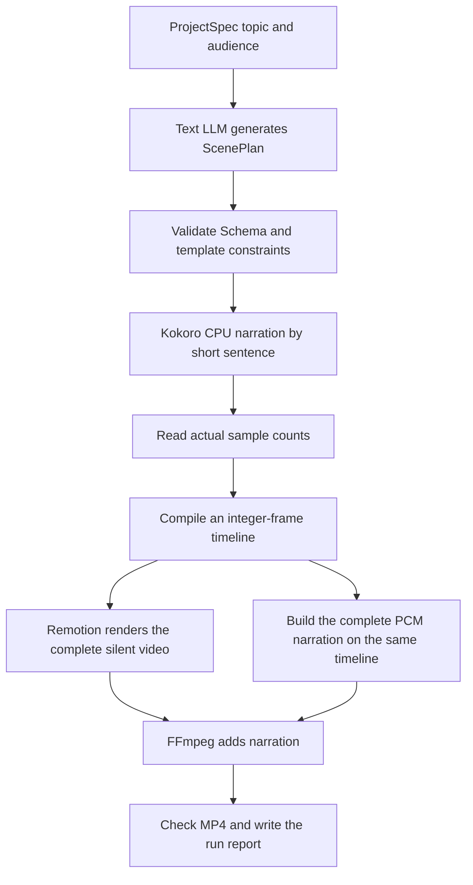

# Project A Week One Implementation Plan

Week one should deliver a reproducible local video-generation prototype: take a topic, target audience, and duration; make a real text LLM call to generate the script and storyboard; synthesize narration with local CPU TTS; and automatically export a 60–90-second MP4 containing two visual templates and short-sentence subtitles. Also complete the project scope, team interfaces, environment instructions, and actual test records to establish a foundation for extending the output to at least seven minutes.

Implementation progress (October 7, 2026): the standalone local English CPU TTS foundation module has been completed. See the repository README for actual usage and `TTS_VERIFICATION.md` for verification results. The complete video pipeline remains a future team implementation target. The "current starting point" below preserves the environment snapshot from when this plan was written; the directories, commands, and interfaces remain planned except for the delivered TTS component.

## 1 Planning assumptions and current starting point

- Plan date: October 7, 2026.
- Current repository: `/Users/leyanyu/Desktop/Traversaal.ai_Capstone`.
- Current state: the `main` branch has an initial commit, README, and Python `.gitignore`, but no project code yet. Untracked `.DS_Store` and Finder `Icon` files were found; handle them through ignore rules without deleting user files.
- Current computer: Apple Silicon, macOS 15.1; the terminal defaults to Node 26.8.1, npm 11.19.0, and Python 3.9.6. FFmpeg, ffprobe, and uv were not found in the current PATH; this does not establish that they are absent elsewhere on the computer.
- Staffing is provisionally estimated at six people, each contributing 8–12 hours per week. Core tasks require approximately 50 person-hours, including short meetings, PR review, and documentation, with another 10–20 person-hours reserved for installation and integration problems. This estimate assumes basic Python/React skills and access to coding assistance; it is not a guaranteed schedule for a beginner team. If only 48 person-hours are available in total, reduce template complexity and reschedule; do not treat contingency time as free.
- The first version provisionally uses English narration, one fixed voice, and one visual style. Update this section once the team confirms staffing, available time, and language.
- Day 1 means the first working day of implementation, and Day 5 means the fifth. They do not have to correspond to Monday through Friday. Regardless of implementation progress, report actual progress every Friday as requested by the advisor.

The final capstone requirements still include a finished video of at least seven minutes, a deployable website, login, and generation history. The short week-one sample is a milestone acceptance test, not a reduction of the final goal.

## 2 Required week-one objectives

| ID | Required deliverable | Passing condition |
|---|---|---|
| G1 | Half-page project description | Explain the target users, problem, inputs and outputs, Level 1 boundaries, and final seven-minute goal; every member can explain it verbally |
| G2 | Working environment | Pin Python, Node, and key dependency versions; independently run a real LLM call, CPU TTS, and local video rendering |
| G3 | Shared data contract | The same scene JSON is accepted by the script, speech, timeline, and rendering modules; invalid data is explicitly rejected |
| G4 | Real end-to-end sample | 60–90 seconds, at least four scenes, two templates, narration, and short-sentence subtitles; no manual repair of intermediate files between input and output |
| G5 | Measurements and issue records | Save actual run configuration, per-stage elapsed time, failures, and audio/video checks; do not invent performance or cost figures |
| G6 | Reproduction by a second member | Another member performs real generation from a clean clone and the README, recording environment differences and problems |
| G7 | Friday delivery package | Playable sample, architecture explanation, acceptance checklist, known issues, short weekly update, and next week's priorities |

P0 consists of the required objectives above. Start P1 only after P0 passes: a second topic, fixed background music, audio caching, resume support, and a seven-minute low-resolution capacity test. The complete website, login, payments, cloud deployment, task queue, history database, video editor, unrestricted asset search, word-level subtitles, multiple languages, and multi-agent orchestration belong to later stages.

Handwritten JSON and test audio may support independent development during week one, but final G4 acceptance must use a real LLM and real local CPU TTS. If a usable API or TTS is unavailable, honestly mark G4 as not passed.

## 3 Technical decisions

### 3.1 Components for this week

| Layer | Week-one choice | Specific purpose |
|---|---|---|
| Orchestration entry point | Python 3.11 command-line program | Validate configuration, execute stages sequentially, save artifacts, and invoke Node and FFmpeg |
| Content generation | A text LLM API with an available quota | Generate structured scenes from the topic and reference facts; select the provider and model on Day 1 |
| Data contract | Pydantic models and exported JSON Schema | Validate in Python; use the same Schema for structural validation in the renderer to prevent two sets of rules from drifting |
| Narration | Kokoro with explicit `device="cpu"` | Provisionally use `lang_code="a"`, `af_heart`, and `speed=1` |
| Visuals | Remotion and TypeScript | Two fixed components, with visuals and subtitles driven by integer frames |
| Audio processing and muxing | FFmpeg and ffprobe | Convert audio specifications, inspect final media, and add the unified narration track to MP4 |
| Local state | One directory and JSON report per run | No database, HTTP service, or background queue is needed in week one |
| Dependency management | Python project virtual environment and lock file; Node npm lock | Allow a second member to install the same versions |

Standardize on Node 22.x and Python 3.11 so team members do not use different default environments. The current Node 26 installation has not been confirmed to be problematic; Node 22 is the team reproduction baseline. Preserve global settings used by other projects when creating the project environment, and do not overwrite the system Python.

The current Kokoro package declares Python >=3.10 and <3.14, so the current system Python 3.9 should not be the project interpreter. [Kokoro dependency declaration](https://github.com/hexgrad/kokoro/blob/main/pyproject.toml)

Remotion's current getting-started page requires macOS 15 or later. Your macOS 15.1 satisfies this condition, but teammates must check their own systems. Pin all `remotion` and `@remotion/*` packages to the same version that actually passes verification, and commit the npm lock file. [Remotion system requirements](https://www.remotion.dev/docs#system-requirements), [Renderer version requirements](https://www.remotion.dev/docs/renderer)

Initially limit direct Python dependencies to Kokoro, soundfile, numpy, Pydantic, one SDK for the selected provider or httpx, and pytest for tests; the command line can initially use the standard-library argparse module. On Node, start with Remotion, its CLI, React, TypeScript, and one JSON Schema validator, and pin all versions after verifying the environment. No additional multi-agent framework is needed for week one.

On Day 1, identify an actually usable text LLM provider, model, credential source, and weekly API quota. Keep credentials in local environment variables, not JSON, logs, or Git. The provider is intentionally not predetermined so the team can use its existing resources; this choice must be settled on Day 1, rather than discovering on Day 4 that calls are unavailable.

### 3.2 Roles of Remotion and HyperFrames

Remotion describes video through React components. The HyperFrames project matching the meeting description uses HTML and animations that can be positioned at a given time. These are two rendering approaches; HyperFrames is not a required dependency of Remotion. [Official HyperFrames documentation](https://github.com/heygen-com/hyperframes)

Use Remotion as the main pipeline this week by default. P0 includes reading both official getting-started guides and recording their different responsibilities. An actual HyperFrames export experiment is P1 by default, limited to two person-hours in total: use the same title and three flow nodes, duration, and resolution to check MP4 export, content changes, and timing control; recording the differences is sufficient.

On Day 1, the PM should confirm whether the advisor requires both frameworks to be used in the final product. If both are required, plan to incorporate HyperFrames output for one scene type into the main Remotion timeline in a later stage. If the advisor requires both during week one, promote verification of both tools to P0 and reallocate D's hours, reduce template visual complexity, or adjust the delivery date; do not unconditionally add two complete implementations to the original budget. Keep the scene data in the main pipeline decoupled from the renderer.

Describe licensing accurately: Remotion officially calls itself source-available, so do not describe the entire stack as having the same open-source license. [Official Remotion FAQ](https://www.remotion.dev/docs/license/faq)

### 3.3 Complete data flow for this week



Intentionally use just one Remotion Composition to render the entire short video. Save scene data in week one, but do not implement scene-video caching. Re-rendering the whole short video after changing a visual segment is an acceptable cost this week; decide whether to render scenes separately during the seven-minute stage based on measured elapsed time.

Encode the narration once at the end, avoiding the need to debug concatenation of multiple clips with AAC audio tracks during week one. If background music is added as P1, process it at the full audio-track level as well.

## 4 Sample scope and content constraints

The provisional primary test topic is "What happens after you enter a website address?", aimed at university students with no networking background. Explain only the main steps of one simplified request. Check the actual script against selected reference material on Day 1 and identify details that are simplified for teaching.

Start with an outline of 4–6 scenes: pose the question, explain address lookup, show the request reaching the server, show the returned result, and summarize. Adjust the scene count to the actual script, but the final sample must have at least four scenes and include both templates.

| Item | Week-one fixed value or constraint |
|---|---|
| Target duration | Write for 75 seconds; actual final duration must be 60–90 seconds |
| Visuals | 1280 × 720, constant 30 fps, landscape |
| Encoding | H.264, yuv420p; AAC for final narration |
| Intermediate audio | 48 kHz, mono PCM WAV |
| Scene templates | `concept` and `flow` |
| Narration | One English voice, fixed speed, synthesized in complete short sentences |
| Subtitles | Correspond to each short-sentence audio block; at most two lines |
| Animation | Frame-driven fade-ins, node highlighting, and sequential appearances |
| Assets | Programmatically drawn text, lines, and shapes; fonts as fixed local resources |
| Transitions | Simple cuts; no overlapping transitions between scenes this week |

An initial draft can start at approximately 140–180 English words, but this is a writing guideline, not a timing basis. If the final duration fails acceptance, add to or condense the explanation and synthesize it again. Do not extend silence, repeat clips, or slow speech unnaturally.

Do not build an automated online research agent in week one. The team should prepare concise, verifiable factual material for the primary topic; give the LLM this material and the permitted scope of simplification. Facts and figures shown should be traceable to that material for checking.

## 5 Data contracts and module boundaries

### 5.1 Which component determines each field

| File | Producer | Contents |
|---|---|---|
| `project-spec.json` | User or test fixture | Topic, audience, language, target duration, and fixed configuration |
| `llm-response.json` | LLM call adapter | Raw content response for this call and non-sensitive call metadata |
| `scene-plan.json` | Validated LLM output | Each scene's purpose, narration, template, and visual data |
| `audio-manifest.json` | TTS module | Audio paths, actual sample counts, model, voice, device, and elapsed time |
| `compiled-timeline.json` | Timeline module | Start frames and durations for scenes and short sentences, subtitles, and visual cues |
| `narration.wav` | Timeline and audio modules | Complete narration track positioned according to the global timeline |
| `video-only.mp4` | Remotion | Complete silent video with a fixed frame count |
| `final.mp4` | FFmpeg muxing module | Combined visuals and narration |
| `run-report.json` | Orchestration and checking modules | Stage status, mode, versions, elapsed time, acceptance results, and errors |

The LLM does not populate actual audio paths, precise seconds, start frames, or duration in frames. The program must calculate these fields from real audio.

### 5.2 ProjectSpec example

```json
{
  "schemaVersion": "1",
  "projectId": "web-request-demo",
  "topic": "What happens after you enter a website address?",
  "audience": "University students with no networking background",
  "language": "en",
  "targetDurationSec": 75,
  "durationRangeSec": [60, 90],
  "allowedTemplates": ["concept", "flow"],
  "themeId": "light-v1",
  "voiceId": "af_heart",
  "video": {"width": 1280, "height": 720, "fps": 30},
  "audio": {"sampleRate": 48000, "channels": 1},
  "referenceFile": "fixtures/reference-primary.md"
}
```

Resolve `referenceFile` relative to the project root and verify that the file exists. Record the reference file's content hash so the program does not retain only a path without a way to determine which reference material was actually used.

### 5.3 ScenePlan example

The following shows fields for only one scene. It is not a complete sample and does not meet the final scene-count or duration acceptance criteria.

```json
{
  "schemaVersion": "1",
  "projectId": "web-request-demo",
  "title": "From an Address to a Web Page",
  "scenes": [
    {
      "id": "scene-01",
      "purpose": "Introduce the main actors in the simplified journey",
      "template": "flow",
      "visual": {
        "title": "A request starts a journey",
        "nodes": [
          {"id": "browser", "label": "Browser"},
          {"id": "dns", "label": "DNS"},
          {"id": "server", "label": "Server"}
        ]
      },
      "narration": [
        {
          "id": "scene-01-line-01",
          "text": "Let us follow a simplified journey from a website address to a web page.",
          "highlightNodeId": "browser"
        },
        {
          "id": "scene-01-line-02",
          "text": "We will look at three parts of that journey: the browser, DNS, and the server.",
          "highlightNodeId": "dns"
        }
      ]
    }
  ]
}
```

The first version of `flow` is limited to 2–4 sequential nodes, automatically connects adjacent nodes, and does not accept arbitrary complex graphs. `concept` uses `visual.title`, `visual.statement`, and at most three `visual.points`; its narration can use `highlightPointIndex` to identify the current point, with static emphasis when no index is specified.

The Schema must distinguish the fields required by the two templates. Suggested initial limits are: titles of at most 60 English characters, node labels of at most 24 characters, individual points of at most 60 characters, and narration blocks of at most approximately 25 English words. These are only first-pass limits; actual text wrapping still requires visual inspection.

JSON Schema handles structural validation of fields, types, lengths, unknown fields, and template variants. Python separately performs semantic validation of duplicate IDs, valid node references, and the relationship between point indexes and array lengths; these checks do not automatically transfer to Node through Pydantic's exported Schema. The renderer reads a validated Timeline but still checks necessary frame ranges and template data. Complete validation should cover unknown templates, empty text, excessively long labels, and the maximum scene count. General rendering permits 1–12 scenes for testing; the formal sample separately requires at least four scenes.

### 5.4 Key audio and timeline fields

Each audio block in `audio-manifest.json` contains at least:

```json
{
  "sceneId": "scene-01",
  "narrationId": "scene-01-line-01",
  "audioPath": "audio/scene-01-line-01.wav",
  "sampleRate": 48000,
  "channels": 1,
  "sampleCount": 153720,
  "device": "cpu",
  "voiceId": "af_heart",
  "speed": 1,
  "synthesisMs": 1250,
  "cacheHit": false
}
```

The sample count and elapsed time above are illustrative field values, not measurements. Read the actual `sampleCount` from the resampled WAV; divide it by the sample rate to obtain the actual duration in seconds.

`compiled-timeline.json` stores fixed video specifications, `totalFrames`, and ordered scenes. Each scene includes complete template data, a global `startFrame`, and `durationFrames`. Each narration segment includes `narrationId`, `audioPath` relative to the current run directory, `sourceSampleCount`, and its scene-relative `localStartFrame`, `durationFrames`, subtitle text, and highlighting cue. Before building the full track, read the WAV again to check that the actual sample count matches the record, rejecting missing files, duplicate narration associations, and audio paths outside the run directory.

Use integer frames and half-open intervals `[startFrame, endFrame)` consistently. The renderer only reads compiled results; it does not re-estimate audio duration.

### 5.5 Module interfaces

| Function or module | Input | Output |
|---|---|---|
| `generate_plan` | ProjectSpec, reference material, LLM configuration | ScenePlan and raw response |
| `validate_plan` | ScenePlan | Validation result or field-level errors |
| `synthesize_narration` | ScenePlan, TTS configuration | WAV files and AudioManifest |
| `compile_timeline` | ScenePlan, AudioManifest, pause configuration | CompiledTimeline |
| `build_narration_track` | CompiledTimeline, WAV files | narration.wav with an exact length |
| `render_video` | CompiledTimeline, render configuration | video-only.mp4 |
| `mux_final` | Silent video, complete narration track | final.mp4 |
| `validate_output` | Timeline, media files, run configuration | Automated inspection report |

All interfaces are local functions or subprocess calls. When Python invokes Node, use an argument array, check the exit code, and save standard error; do not concatenate the user's topic into a shell command.

## 6 Detailed module implementation

### 6.1 LLM planning module

1. Read the topic, audience, target duration, reference material, and descriptions of both templates.
2. Generate a short outline and per-scene narration in the same request, avoiding a multi-agent setup in week one.
3. Use JSON Schema when the provider supports structured output; still run the same validation locally.
4. Save the raw response, then parse and validate it. Do not log API keys or complete authentication headers.
5. If validation fails, allow only one repair request containing the error list; if it still fails, exit and retain the evidence.
6. Retry 429 responses or temporary service errors at most twice and record them; report explicit authentication errors immediately without repeated retries.
7. For each call, record the actual model identifier, prompt version, latency, and token usage returned by the provider. Mark cost as unknown when reliable billing data is unavailable.
8. Stabilize the factual material and prompt before refining the language; factual correctness for arbitrary topics is not promised this week.

If the actual synthesized duration falls outside 60–90 seconds, a new run may be started after modifying the input reference requirements or regenerating the script. Retain the original run as not passed. The final successful run must still complete its internal flow automatically, without quietly editing its generated files by hand.

### 6.2 CPU TTS module

1. Install and pin verified Kokoro, audio-processing, and necessary language dependencies in the Python 3.11 project environment.
2. Initialize CPU execution explicitly rather than relying on automatic device selection:

```python
KPipeline(lang_code="a", repo_id="hexgrad/Kokoro-82M", device="cpu")
```

3. Initialize the model only once per process and process short narration sentences sequentially, avoiding reloading weights for every sentence.
4. Collect all audio chunks returned by the Kokoro generator and concatenate them in order; do not save only the first chunk.
5. The official example outputs 24 kHz; standardize to 48 kHz mono PCM, save WAV, and then read the actual sample count.
6. Check that audio is nonempty, decodable, has a consistent sample rate, and contains valid numerical values; manually listen to the primary sample's proper nouns, beginning, ending, and pauses between sentences.
7. Record three separate times: initial model and voice download, model loading, and inference alone. Do not combine downloads and warm starts from cached assets into one performance figure.
8. Verify that espeak-ng is available on Mac, paying particular attention to unfamiliar words being skipped. Prepare three initial sample types: ordinary sentences, abbreviations or proper nouns, and long sentences.

The CPU initialization and audio-generation interfaces are based on the [Kokoro source code](https://github.com/hexgrad/kokoro/blob/main/kokoro/pipeline.py) and [official examples](https://github.com/hexgrad/kokoro). CPU narration does not mean browser rendering uses no graphics hardware; consistently describe the setup as "local CPU TTS and local video rendering" in reports.

### 6.3 Timeline and subtitles

Fix audio at 48,000 Hz and video at 30 fps, so each frame corresponds to exactly 1,600 audio samples:

```text
samplesPerFrame = 48000 / 30 = 1600
speechFrames = ceil(sampleCount / 1600)
sceneFrames = leadFrames + sum(speechFrames) + sum(gapFrames) + tailFrames
```

Initially use pauses of 6 frames at the start of a scene, 3 frames between sentences, and 6 frames at the end of a scene. Pauses already produced by TTS are included in its sample count. Adjust these settings if the result feels slow rather than arbitrarily cutting the original speech.

To build the complete narration, first allocate `totalFrames × 1600` zero samples, then place each real speech segment according to its global start frame. The sub-frame silence introduced by rounding each sentence up to a whole frame must actually remain in the audio track, so the timeline, subtitles, and sound share one clock.

Display subtitles within the frame range corresponding to the current audio block. Shorten long sentences naturally during LLM planning, or synthesize them again at clear short-sentence boundaries; do not divide time evenly by character count and present it as word alignment. Use at most two lines in a fixed bottom safe area, avoiding the main diagram content.

Calculate duration before rendering visuals. Drive every animation from the current frame number or scene-relative frame number, without using the real system clock or unfixed random values.

### 6.4 Remotion templates and rendering

- `ConceptScene`: a title, one core explanation, and at most three short points; highlight points progressively according to narration blocks.
- `FlowScene`: a title, 2–4 nodes, and arrows between adjacent nodes; the current narration block highlights its specified node.
- `Subtitle`: a shared component that reads timeline subtitles and does not invoke an LLM or TTS from inside the component.
- `ExplainerVideo`: the only Composition; set duration from `totalFrames` and place scenes using `startFrame`.
- `theme.ts`: standardize fonts, font sizes, colors, margins, and the subtitle area. Do not implement user-selectable themes in the first version.
- Start with render concurrency set to 1 and adjust after measuring, avoiding resource contention between TTS and rendering.

Remotion supports input props and dynamic metadata, making it suitable for reading compiled JSON. [Parameterized rendering](https://www.remotion.dev/docs/parameterized-rendering), [Dynamic duration](https://www.remotion.dev/docs/calculate-metadata)

The implemented command will take the following form; we must first create the entry file and composition:

```bash
npx remotion render src/index.ts ExplainerVideo ../runs/demo/video-only.mp4 --props=../runs/demo/compiled-timeline.json --concurrency=1
```

Run this command inside `renderer/`. The week-one Composition contains no audio track; audio is added in the next stage. The entry point, composition, output location, and JSON props syntax come from the [Remotion CLI documentation](https://www.remotion.dev/docs/cli/render).

### 6.5 Final muxing and inspection

FFmpeg reads the silent video and narration.wav, preserves the video stream, encodes the complete narration as AAC, and writes final.mp4. Do not hide timeline inconsistencies through unconditional trimming; check both durations before muxing.

Use ffprobe to inspect the video track, audio track, resolution, frame rate, frame count, codecs, and duration; perform a full decode check to detect damaged files. Watch the entire result even after automated checks pass. An exit code of 0 does not establish that the finished video's quality has passed. [Official ffprobe documentation](https://ffmpeg.org/ffprobe.html)

Before encoding, the WAV sample count must equal `totalFrames × 1600` exactly, and the video frame count must equal `totalFrames` exactly. Final AAC audio may contain encoder padding. For the first inspection threshold, allow no more than 0.1 seconds of difference between audio and video durations in the container, and check that the final sentence is not cut off.

### 6.6 Run state and debuggability

The state sequence is `created → planning → validating → tts → timing → rendering → muxing → checking → completed`. A failure at any stage enters `failed` and records the failed stage and scene ID. The report separates execution state `pipelineStatus` from quality state `acceptanceStatus`: the former indicates execution in progress, completed, or failed; the latter is pending, passed, or failed. When automated processing has finished but nobody has watched the video yet, acceptanceStatus remains pending. A sample that fails duration or quality checks cannot be marked passed.

Save artifacts and stage records after each stage completes, before proceeding to the next. P0 permits re-running the downstream pipeline from a validated ScenePlan; this is a development or recovery run, not a new real-LLM end-to-end acceptance run.

Add audio caching and resume support in P1. Cache keys must include text, voice, speed, language, model, and preprocessing version. Visual changes still require re-rendering the entire short video; regeneration of individual scene videos is not promised this week.

At minimum, the run report records `planSource`, `audioSource`, `cachePolicy`, dependency versions, content hashes, elapsed time per stage, and final check results. Label fixture runs, actual inference using previously downloaded model weights, and reuse of cached audio results separately; do not present cache-hit speed as actual generation speed.

## 7 Planned repository structure

By the end of week one, the repository should have the following core structure. Create files gradually within their respective tasks; do not create large numbers of empty directories on the first day.

```text
Traversaal.ai_Capstone/
├── README.md
├── .gitignore
├── .env.example
├── .python-version
├── .nvmrc
├── requirements.txt
├── requirements.lock
├── pipeline/
│   ├── __init__.py
│   ├── __main__.py
│   ├── cli.py
│   ├── config.py
│   ├── schemas.py
│   ├── planner.py
│   ├── tts.py
│   ├── timing.py
│   ├── render.py
│   ├── media.py
│   └── report.py
├── schemas/
│   ├── project-spec.schema.json
│   ├── scene-plan.schema.json
│   └── compiled-timeline.schema.json
├── prompts/
│   ├── scene-planner.txt
│   └── repair-scene-plan.txt
├── fixtures/
│   ├── project-spec.primary.json
│   ├── reference-primary.md
│   ├── scene-plan.valid.json
│   └── scene-plan.invalid.json
├── renderer/
│   ├── package.json
│   ├── package-lock.json
│   ├── tsconfig.json
│   ├── public/fonts/
│   └── src/
│       ├── index.ts
│       ├── Root.tsx
│       ├── ExplainerVideo.tsx
│       ├── theme.ts
│       ├── validation.ts
│       └── components/
│           ├── ConceptScene.tsx
│           ├── FlowScene.tsx
│           └── Subtitle.tsx
├── tests/
│   ├── test_contracts.py
│   ├── test_timing.py
│   └── test_pipeline_failures.py
├── docs/
│   ├── WEEK_01_PLAN.md
│   ├── project-spec.md
│   ├── architecture.md
│   ├── setup.md
│   ├── decisions.md
│   └── week-01-results.md
└── runs/                          # Local artifacts; do not commit to Git
    └── <run-id>/
        ├── project-spec.json
        ├── llm-response.json
        ├── scene-plan.json
        ├── audio-manifest.json
        ├── compiled-timeline.json
        ├── audio/
        ├── narration.wav
        ├── video-only.mp4
        ├── final.mp4
        ├── run-report.json
        └── logs/
```

Python's `requirements.txt` lists direct dependencies, while `requirements.lock` records the exact resolved versions from the verified environment; the README identifies the platform used for verification. Commit Node's `package-lock.json` and reproduce its environment with `npm ci`. `.nvmrc` and `.python-version` declare version conventions; they do not install or switch runtimes for the user by themselves.

Extend `.gitignore` to include Node dependency directories, rendered output, `runs/`, model caches, temporary files, and macOS metadata. Ignore `.env` and `.env.*` by default, with a specific exception for `.env.example` containing only field names and explanations. Keep model weights and finished videos locally or in a separately designated delivery location; the code repository stores the code, configuration, and fixtures needed to regenerate them.

Initially include in `.env.example` only fields actually used by the provider adapter, such as `LLM_PROVIDER`, `LLM_MODEL`, and `LLM_API_KEY`. Do not design configurations for a dozen providers in advance. Store non-sensitive settings such as the TTS model, voice, device, and duration in normal configuration files and the run report.

## 8 Entry commands and output conventions

The following commands describe the interface to implement this week; they cannot yet be executed as an existing program. After implementation, commands in the README must match the actual help output item by item.

```bash
# Check environment and configuration without using LLM quota by default
python -m pipeline doctor

# Validate scene data only
python -m pipeline validate --plan fixtures/scene-plan.valid.json

# Day 3 isolated integration mode: no LLM call, still uses real CPU TTS
python -m pipeline run --plan fixtures/scene-plan.valid.json --out runs/fixture-smoke

# Day 4 formal mode: real LLM + real CPU TTS + actual rendering
python -m pipeline run --brief fixtures/project-spec.primary.json --out runs/demo-primary

# Check completed output
python -m pipeline check --run runs/demo-primary
```

`--brief` and `--plan` are mutually exclusive. `--plan` uses the shared week-one defaults: English, af_heart, CPU, 720p, 30 fps, 48 kHz, and 6/3/6-frame pauses; write the resolved effective configuration into the run directory. `--brief` reads permitted overrides from ProjectSpec and rejects specifications unsupported in week one. Configuration forces CPU by default. If fixture audio is used for testing, the report must explicitly label it rather than presenting it as formal mode. Use a new output directory for every formal run; refuse to overwrite an existing nonempty directory by default.

`doctor` checks the project Python and Node versions, FFmpeg/ffprobe, dependency imports, fonts, output-directory writability, and completeness of LLM configuration. Checks requiring paid online calls or model downloads are separate smoke tests; an environment query must not implicitly trigger large downloads or calls.

`run-report.json` stores at least:

- Run ID, start and end times, completed or failed status, Git commit ID, and whether the working tree has uncommitted changes.
- OS, chip architecture, and Python/Node/key package versions; record memory only when it can be obtained reliably.
- Actual LLM provider and model, TTS model and voice, device, frame rate, and resolution.
- `planSource: live_llm | fixture`, `audioSource: local_cpu_tts | fixture`, and use of cached results.
- Wall-clock elapsed time for each stage, model download and loading times, actual inference time, actual audio duration, and video frame count.
- Artifact paths and input hashes; failed stage, scene ID, and error summary.
- Automated check results and separately completed manual acceptance results.

## 9 Six-person responsibilities and dependencies

A through F are roles to assign, not students who have already been appointed. Each module has a primary owner and a partner who can review its interface.

| Role | Main responsibilities | Week-one core budget | Main handoff |
|---|---|---:|---|
| A Integration lead and PM | Scope, entry point, stage connections, requirement confirmation, final demo | 10 hours | Align output files and failure conventions with every module |
| B Scripts and contracts | Schema, LLM adapter, prompts, reference material, format validation | 8 hours | Provide valid and invalid scene fixtures to C, D, and E |
| C Narration | CPU TTS, preserving all chunks, WAV specifications, actual sample counts | 8 hours | Provide AudioManifest and real audio to E |
| D Visuals | Environment experiments, two components, subtitle component, silent-video export | 10 hours | Confirm frame ranges with E; provide the rendering entry point to A |
| E Timeline and media | Integer-frame calculations, complete narration track, subtitle boundaries, final muxing | 7 hours | Verify synchronization with C and D; provide the muxing entry point to A |
| F Environment reproduction and QA | Environment instructions, tests, reproduction on a second machine, results | 7 hours | Follow installation from Day 1 and perform independent acceptance on Day 5 |
| Total | Excludes additional contingency | 50 hours | Reserve another 10–20 person-hours |

Key dependencies: agree on the Schema first; C and D develop in parallel using fixed fixtures; E compiles the timeline after C produces real audio; A connects C, E, and D on Day 3; B connects real LLM output to the already working downstream pipeline on Day 4. F follows progress throughout, rather than beginning installation for the first time on the final day.

## 10 Daily tasks and completion gates

### Day 1 Confirm scope and establish collaboration foundations

Approximately 9 team person-hours, with primary owners expected to spend 1–2 hours each.

**W1 01 Scope and resource confirmation, owned by A.**

1. Take no more than 45 minutes to settle the target-user hypothesis, English baseline, two templates, primary test topic, and 60–90-second week-one sample.
2. Confirm the six roles and actual availability; reschedule immediately if staffing or available time is insufficient, rather than waiting until Friday to admit the workload does not fit.
3. Select an LLM API that can actually be called; also clarify the second member's credential source, model permissions, and call quota for reproduction. Confirm only configuration availability; do not collect plaintext keys in group chats, documents, or Git.
4. Write the half-page `docs/project-spec.md`, explaining the final goal of at least seven minutes and that Level 1 does not use heavyweight video-generation models.
5. Confirm the final deadline and dual-renderer requirement; directly record scope already confirmed with the advisor rather than sending it again.

Completion evidence: half-page description, role table, LLM provider and model decision, and list of outstanding questions.

**W1 02 Repository and environment baseline, owned by A and F.**

1. Confirm that teammates have accepted the repository invitation and can clone it.
2. Establish feature-branch and PR conventions, extend ignore rules, and add `.env.example` with empty values.
3. Select project-isolated Python 3.11 and Node 22 environments; check FFmpeg, ffprobe, and espeak-ng.
4. Record each member's OS and architecture, particularly whether the system meets the current Remotion requirements.
5. Put installation steps that actually succeeded in `docs/setup.md`, and record failed commands and their causes in the issue list.

Completion evidence: an environment checklist other members can understand; preliminary checks completed on the local machine; the system environment has not been globally replaced with another version.

**W1 03 Freeze the first data fixture, owned by B, E, and D.**

1. Define fields and units for ProjectSpec, ScenePlan, and Timeline.
2. Write one valid ScenePlan containing both templates and one invalid fixture for validation.
3. Confirm how all IDs, scene ordering, short-sentence subtitles, and highlighted nodes relate.
4. B provides a limited set of reference facts for generation and subsequent manual checking.
5. C and D begin development with this fixture the same day instead of inventing separate JSON formats.

**Day 1 gate:** everyone can point to the same fixture and knows what they receive and produce; real LLM access for both the primary developer and second member performing reproduction is available or explicitly recorded as blocked; website page development has not started.

### Day 2 Run the key components independently

Approximately 11 team person-hours. Keep each experiment small; visual polish is not the priority.

**W1 04 Real LLM experiment, owned by B.**

1. Generate 2–3 scenes with the selected provider.
2. Validate JSON and template constraints; record one real response and model identifier.
3. Supply excessively long labels or references to nonexistent nodes and verify that errors are reported.
4. Add at most one format-repair attempt; stop if the result still fails after that limit.
5. F makes a minimal real call from their own environment using their configuration, exposing permission or quota blockers for the second member early.

Completion evidence: a real generated ScenePlan that passes validation and a readable error message.

**W1 05 Local CPU narration experiment, owned by C with F following along.**

1. Download and initialize the fixed model and voice, confirming CPU configuration.
2. Synthesize three short sentences separately and ensure the complete audio is saved.
3. Play and inspect them; save original and standardized audio plus AudioManifest.
4. Measure cold start and inference after the model has loaded.
5. Give F the installation instructions for review.

Completion evidence: playable 10–20-second speech, actual sample counts, CPU logs, and elapsed-time records.

**W1 06 Visual and renderer experiment, owned by D.**

1. Create a minimal Remotion project and first export 10–15 seconds of silent visuals.
2. Accept the sample JSON and replace titles, node labels, and duration in frames.
3. Read and record how HyperFrames differs in responsibility from the main approach; the actual comparative export experiment is P1 and should be done only after the core components work and capacity remains.
4. Build minimal versions of ConceptScene and FlowScene without complex transitions.
5. Record the actual browser, dependency versions, and export time.

Completion evidence: a playable MP4, parameterized templates, and a record of the main rendering decision.

**W1 07 Timeline functions, owned by E.**

1. Feed in test audio with whole-frame and non-whole-frame durations and calculate integer frames.
2. Place each sentence's start and end frames inside its scene, then accumulate global scene start frames.
3. Build a WAV with an exact sample length from the same timeline.
4. Confirm with D whether subtitles and highlighting use scene-relative or global time.

**Day 2 gate:** a real LLM call, real CPU TTS, and real video export have each succeeded at least once. If any is missing, prioritize removing that blocker the next day; other modules can continue developing with clearly labeled fixtures.

### Day 3 Connect audio and visuals using fixed scene data

Approximately 12 team person-hours. A owns integration, with C, D, and E debugging together.

**W1 08 Downstream integration.**

1. Implement the `run --plan` entry point to read a handwritten ScenePlan.
2. Invoke real TTS, saving all audio and AudioManifest.
3. Compile the timeline and generate the complete narration.wav.
4. Pass the compiled result to Remotion and export silent video with the exact frame count.
5. Add narration through FFmpeg to produce final.mp4.
6. Run media checks, then play the entire video.
7. Check subtitles, node highlighting, pauses between sentences, scene changes, and the final sentence.
8. Keep all intermediate files; locate errors at the specific stage and scene.

**W1 09 Targeted checks, owned by F.**

- A missing audio file must cause an explicit failure, rather than being skipped while success is still claimed.
- Excessively long labels must be exposed by validation or layout checks, rather than silently clipping important content.
- The timeline's total frame count must correspond exactly to the complete WAV sample count.
- Main content and subtitles must not overlap in either template.

**Day 3 gate:** a complete multi-scene video driven by handwritten JSON plays correctly and includes both templates. This demonstrates successful downstream integration but does not yet count as acceptance of real topic-to-video generation for the week.

If no playable result exists by the end of Day 3, the entire team pauses P1 and focuses on fixing the earliest failing stage. If necessary, diagnose the issue with a very short two-scene clip before restoring the formal short-video target.

### Day 4 Connect real topic-based generation

Approximately 10 team person-hours.

**W1 10 Complete the formal entry point, owned by A and B.**

1. Implement `run --brief` to connect a real LLM ScenePlan to Day 3's downstream pipeline.
2. Save configuration and status throughout the process, correctly distinguishing live, fixture, and cache modes.
3. Start a new run from the primary topic without manually modifying JSON or audio along the way.
4. Check whether actual duration is 60–90 seconds; mark out-of-range runs as not passed, adjust script requirements, and generate a new run.
5. Clarify error messages for authentication, format, TTS, and rendering failures.
6. Record actual bottlenecks and decide from measurements whether to reduce visual complexity.

**W1 11 Quality fixes, owned by C, D, E, and F.**

- Check the script's core facts and terminology.
- Listen to proper nouns, pauses between sentences, and the final sentence, checking for omitted words.
- Inspect subtitle readability, main-text wrapping, and correspondence between highlighting and the current narration block in every scene.
- Fix templates or prompts and rerun the whole process. Correct problems through code or input configuration instead of manually patching final artifacts.

**Day 4 gate:** at least one 60–90-second video has been generated automatically from a real topic input; real LLM calls, real CPU TTS, and actual rendering all have evidence; major audio or visual problems have been resolved.

### Day 5 Independent reproduction and delivery

Approximately 8 team person-hours.

**W1 12 Reproduction by a second member, owned by F.**

1. The second member starts from a clean clone, the project runtime environment, and their own local configuration.
2. Follow the README to install dependencies, run doctor, and execute a real `run --brief`.
3. Work only from the documentation; if an undocumented step requires asking the author, add it to the README and continue.
4. Save versions, elapsed time, and results from the second environment, recording cross-system problems honestly.
5. Execute another new run in the first environment instead of retaining only a single successful record.

**W1 13 Results and demonstration, owned by A and F with the whole team participating.**

1. Mark acceptance items passed, failed, or untested, attaching artifact paths or records.
2. Write `docs/week-01-results.md` with actual elapsed times, known issues, and week-two priorities.
3. Each member explains the inputs, outputs, and their module in their own words; at minimum, everyone can draw the whole workflow.
4. Rehearse a 3–5-minute demonstration covering the product goal, complete sample, real data flow, elapsed time, and limitations.
5. Prepare a 3–4-line Friday update, to be sent after the team confirms the facts.
6. If P0 has passed and capacity remains, run the seven-minute low-resolution capacity test; it must not displace reproduction or documentation.

**Day 5 gate:** all seven G objectives have inspectable status and evidence; reproduction by the second member has passed; the demonstration clearly separates implemented functionality, known shortcomings, and next week's plans.

## 11 Acceptance checklist and measurement methods

The following are proposed week-one engineering acceptance criteria, not numerical thresholds already specified by the advisor.

| Check | Passing standard | Verification method |
|---|---|---|
| Real content generation | This run calls a real text LLM to generate scenes from a topic | Run mode, model identifier, raw response |
| Real CPU narration | Explicit CPU use, real synthesis for every sentence, all chunks collected | Configuration, logs, WAV, sample counts |
| Duration | Finished video is 60–90 seconds | Timeline and ffprobe |
| Output specifications | 1280×720, 30 fps, H.264, decodable audio track | Media metadata and decode checks |
| Scenes | At least four; both Concept and Flow appear | Compare ScenePlan with finished video |
| Timeline | No unintended overlap or gaps between adjacent scenes; subtitles remain within bounds | Boundary tests and JSON checks |
| Exact length | WAV sample count equals total frames multiplied by 1600; video frame count matches | Programmatic checks |
| Audio/video ending | Displayed audio/video durations differ by at most the initial 0.1-second threshold; final sentence is complete | ffprobe plus manual listening and viewing |
| Subtitles | Every narration block has corresponding subtitles, at most two lines, without obvious overflow | Full viewing and key-frame inspection |
| Visuals | Main content does not overlap subtitles, nodes are distinguishable, and highlighting matches the current sentence | Manual viewing |
| Content | No obvious internal contradictions; core facts can be checked against references | Cross-check by team members |
| Automation | No manual repair of intermediate files within one formal run | Process and logs |
| Reproduction | Second member completes real mode; documentation is sufficient | Independent reproduction record |
| Failure handling | Invalid data and missing audio fail explicitly while retaining debugging information | Two failure fixtures |
| Repository hygiene | Code, lock files, fixtures, and documentation are present; no secrets or large artifacts | PR and pending-file review |

Implement at least three useful groups of automated checks: the contract rejects illegal input; timing handles whole-frame and non-whole-frame boundaries; missing files or failed subprocesses report errors correctly. Run real-model end-to-end and rendering tests separately, without redownloading models or consuming API quota for every small change.

Do not set an unmeasured requirement that generation must finish within a certain number of minutes. Record `T_llm`, `T_model_load`, `T_tts`, `T_render`, `T_mux`, `T_total`, and video duration. Calculate `T_tts / narration_duration` and `T_total / video_duration` as comparison metrics if useful. Report initial download, real inference with the model already loaded, and reruns using cached artifacts separately.

Two or three successful runs establish only that those examples passed; they do not justify claiming a measured stable success rate or production reliability.

If the seven-minute capacity test is completed, label it a technical test. It may reuse scenes and narration while recording memory, elapsed time, and failures; it does not prove the coherence of an original seven-minute script or replace final long-video acceptance.

## 12 GitHub collaboration

For week one, maintain one shared repository, one `main` branch, and a few short-lived feature branches. Each PR should address one clearly describable, verifiable change. [GitHub flow](https://docs.github.com/en/get-started/using-github/github-flow)

The recommended merge order follows; these branch names are proposed and have not yet been created:

1. `chore/week1-foundation`: documentation, ignore rules, environment conventions, fixtures, and shared contracts.
2. `feat/cpu-tts`: audio generation and AudioManifest.
3. `feat/video-templates`: two templates and rendering of fixed fixtures.
4. `feat/timeline`: actual audio timing, subtitle boundaries, and the complete narration track.
5. `feat/llm-planner`: real API integration and ScenePlan validation.
6. `feat/local-pipeline`: shared entry point, final muxing, and run report.
7. `test/week1-acceptance`: necessary boundary checks, reproduction instructions, and results.

These are work packages, not a requirement to develop all seven PRs sequentially in numbered order. Merge the shared contract first; TTS, templates, and the LLM can proceed in parallel while the integration lead continually pulls in approved components.

Each PR should state at least what changed, how to run it, verification results, and known limitations. Have another member review it before merging. GitHub Desktop supports branches, commits, pushes, and creating PRs. Do not let multiple independent tasks switch to different branches simultaneously in the same working directory.

If the current GitHub plan supports private-repository branch protection, configure required reviews and checks. Otherwise, follow team conventions without blocking week one. Availability of branch protection for private repositories depends on the account plan. [GitHub branch protection documentation](https://docs.github.com/en/repositories/configuring-branches-and-merges-in-your-repository/managing-protected-branches/about-protected-branches)

Issues can track W1 01 through W1 13, but there is no need to split week one into dozens of cards. Each item should include at least an owner, P0/P1 priority, dependencies, and completion criteria. Close a task only when both artifacts and acceptance evidence are complete.

If Day 2 projections exceed the core budget, move comprehensive automated environment diagnostics, hashing of all artifacts, and nonessential metadata collection to P1. Keep a small set of explicit checks in the P0 doctor; the run report must retain actual mode, key versions, inputs and intermediate artifacts, stage timings, error locations, and acceptance status.

## 13 Risks and scope-reduction paths

| Trigger | Preferred response | Effect on acceptance |
|---|---|---|
| No usable LLM access on Day 1 | Secure the team's existing API access and quota that day; other modules use fixtures temporarily | Fixtures cannot satisfy G4 |
| Python dependency installation fails | Switch to project Python 3.11, pin versions that actually work, and preserve the error | Do not force continued work with system Python 3.9 |
| Model download fails | Distinguish network, disk, and dependency problems; retry from official sources | Prerecorded audio cannot replace real TTS |
| A teammate's macOS does not meet current rendering requirements | Choose another officially supported machine or platform and record the reproduction environment | Do not promise support on unverified older systems |
| TTS omits words or has awkward phrasing | Shorten natural semantic blocks, standardize terminology spelling, and check language dependencies | Resynthesis and listening checks are required |
| LLM scenes are invalid | Constrain templates and fields, allowing at most one format repair | Explicitly exit if the result still fails |
| Rendering is very slow | Begin with concurrency 1, simplify visuals, and use lower resolution only for development previews | If formal 720p output is unfinished, mark that item as not passed |
| No playable video by Day 3 | Focus on the earliest failed stage and pause all P1 work | Building a webpage does not compensate for an unfinished main pipeline |
| Duration fails acceptance | Adjust content requirements and start a new run | Do not fill the formal sample with silence, slowed playback, or repeated content |
| Second member cannot reproduce the result | Fix the README and environment instructions; narrow supported platforms if necessary | G6 remains not passed until successful |
| Insufficient total hours | Remove P1 first, then reduce visual complexity while retaining two simple templates | If still insufficient, explicitly defer objectives; do not count mocks as completed work |

With only 3–4 people, combine B with some PM content work, C with E, D with rendering orchestration, and F with team-wide cross-checking, then reallocate available hours. With only 1–2 people and fewer than 25 total hours, first complete the environment and a working loop with fixed fixtures, then schedule real LLM integration and independent reproduction. This is a reduced milestone delivery, not completion of the original six-person plan.

Recheck available hours and blockers no later than the evening of Day 2. If environment risks consume the contingency, prioritize real models, correct timing, automatic output, and reproducible documentation.

## 14 Friday delivery and the transition to week two

The delivery package contains the primary sample, runnable code, half-page spec, operating instructions, architecture diagram, at least one real complete-run report, second-member reproduction record, acceptance status, known issues, and next week's priorities.

Prepare a five-minute demonstration:

1. Spend approximately 30 seconds explaining user inputs and outputs and the week-one objective.
2. Play the complete 60–90-second sample.
3. Spend approximately 60 seconds explaining how the topic connects to the script, audio, timeline, and visuals.
4. Show versions, CPU configuration, and per-stage elapsed time from one real run.
5. Demonstrate a locatable error or the rerun steps after changing narration.
6. Explain the two most important limitations and what will be addressed next week.

Do not depend on a complete live render finishing within the demonstration window. You can start a task live while playing a previously completed, documented real sample, identifying the run it belongs to.

The Friday update should contain only actual results: what was completed this week, current blockers, and next week's work. State incomplete real API integration, CPU verification, or second-member reproduction directly rather than concealing them with wording such as "end-to-end is basically complete."

Select week-two priorities from week-one evidence:

- The short video passes, but content transitions are weak: start with a long outline, chapter context, and checks for repetition.
- Short-video quality is acceptable, but rendering is slow: measure seven-minute capacity before choosing per-scene rendering and caching.
- The local pipeline is repeatable: wrap it in an API and background tasks, then connect input, progress, and history pages.
- Gradually extend formal output to at least seven minutes and cover multiple advisor-suggested topics to test generality.

## 15 Our step-by-step implementation sequence

Each subsequent round should produce a small, inspectable result. Record completion before continuing rather than building every module at once.

| Round | What we will do | What you should see at the end |
|---|---|---|
| 1 | Confirm the repository write location; establish foundation files, environment conventions, and the first task branch | A clear README, ignore rules, and project version instructions |
| 2 | Finalize the Schema and fixtures for both templates | JSON that passes validation and an invalid fixture with an explainable error |
| 3 | Configure Python 3.11 and CPU TTS | Real speech you can play and recorded elapsed time |
| 4 | Set up Remotion and the two components | An actually exported silent video |
| 5 | Integrate the timeline, subtitles, and audio muxing | A multi-scene short video automatically generated from handwritten JSON |
| 6 | Integrate the team's chosen real LLM | A 60–90-second sample automatically produced after entering a topic |
| 7 | Run acceptance checks and reproduction, and collect facts for the weekly update | A clear passed/failed checklist and code the team can use |

Different members may work on these rounds in parallel; dependencies still follow Day 1–5. Handle dependency installation, paid service calls, commits, and pushes according to the actual implementation task. This plan itself has not installed software for the team, created remote Issues, sent emails, or pushed code.

## 16 Pre-start confirmation checklist

- [ ] Actual team size and hours each member can contribute this week.
- [ ] Whether English is confirmed as the week-one narration language.
- [ ] Half-page description of the target users and business problem.
- [ ] One usable text LLM provider, specific model, and weekly API quota.
- [ ] The second member responsible for independent reproduction and their computer environment.
- [ ] The advisor's final deadline and whether both renderers must be represented.

These outstanding details do not prevent beginning shared contracts, templates, and CPU narration verification. Final real-LLM acceptance depends on actual API configuration; waiting for it must not be treated as already having it.
